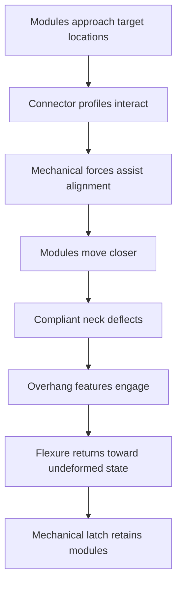

# Latching X-Face: Design, Principles, and Testing of a Latching Modular Robot Connector

> **How can two modular robots mechanically connect with low docking force while maintaining a strong connection once latched?**
>
> This paper presents a passive, compliant, two-layer mechanical connector that combines the self-alignment capabilities of the X-Face with a mechanical latching mechanism. The connector is designed to engage through the motion of the robot modules themselves, without a powered latch actuator.

---

## 1. Paper Overview

| | Details |
|---|---|
| **Title** | Design, Principles, and Testing of a Latching Modular Robot Connector |
| **Authors** | Nick Eckenstein and Mark Yim |
| **Conference** | IEEE/RSJ International Conference on Intelligent Robots and Systems (IROS) |
| **Year** | 2014 |
| **DOI** | [10.1109/IROS.2014.6942953](https://doi.org/10.1109/IROS.2014.6942953) |
| **Paper** | [Original PDF](https://www.modlabupenn.org/wp-content/uploads/latching_xface_overlay.pdf) |
| **Research Lab** | GRASP Lab, University of Pennsylvania |

---

## 2. Motivation

Modular robotic systems consist of individual modules that can physically connect and disconnect to form different robotic configurations. Reconfiguration allows robots to adapt their morphology to different tasks, environments, or structural requirements.

However, connecting two modules reliably is not trivial.

During docking, the modules may have relative position or orientation errors. These errors can become increasingly significant in chain-style modular robots as the chain grows longer and positional errors accumulate.

A docking operation consists of two fundamental stages:

- **Alignment:** Bringing the mating connector faces into a sufficiently accurate relative position and orientation.
- **Latching:** Establishing a physical connection that maintains the alignment and prevents the modules from separating.

The earlier X-Face connector focused primarily on passive self-alignment. The Latching X-Face extends this concept by introducing a compliant mechanical latch that retains the modules after engagement.

### Design objectives

The authors aim to develop a connector that:

- Provides passive mechanical latching.
- Requires relatively low force to engage.
- Achieves high strength once latched.
- Tolerates initial positioning errors.
- Does not require a powered latch actuator during engagement.
- Is compatible with planar modular robot docking systems such as the X-Face.

The central design objective is to achieve **a low connection force while maintaining a high bonding strength**.

---

## 3. The X-Face and the Latching X-Face

The Latching X-Face builds upon the earlier X-Face, a planar passive mechanical connector developed for modular self-reconfigurable robots.

The original X-Face focuses on self-alignment. Its geometry allows two mating connector faces to correct certain relative positioning errors during docking.

The Latching X-Face extends this geometry by incorporating compliant features that mechanically retain the modules once they engage.

| X-Face | Latching X-Face |
|---|---|
| Primarily designed for passive self-alignment | Combines self-alignment with mechanical retention |
| Corrects certain relative position errors | Corrects errors and mechanically latches |
| Mating geometry guides the faces together | Mating geometry guides and retains the faces |
| Focuses on area of acceptance | Focuses on alignment, latching and bonding strength |

The Latching X-Face uses complementary, hermaphroditic connector geometries. Each mating face incorporates features that allow the two connectors to engage without requiring a separately defined male and female connector.

The design uses two layers of material, making it a planar connector with a two-layer, or 2.5D, geometry.

**The connector does not use magnets. Attachment is achieved through mechanical interaction, elastic deformation and interlocking geometry.**

---

## 4. Mechanism Architecture

The Latching X-Face consists of complementary mating profiles incorporating flexible latch features.

The connector's geometry is designed so that when two modules approach one another, the contact forces generated by the profiles guide the connectors into alignment and deform the compliant sections.

As the modules move closer, the compliant features deflect. Once the mating profiles pass through the required engagement geometry, the compliant sections return toward their undeformed positions, allowing the latch features to engage.

The resulting connection is mechanically retained.

### 4.1 Important geometric features

The paper identifies the following components in Fig. 2.

| Feature | Description | Mechanical function |
|---|---|---|
| **Shape profile** | Curved mating profile | Generates contact forces that assist alignment and engagement |
| **Overhang** | Projecting feature of the profile | Provides mechanical retention against separation |
| **Compliance neck** | Narrow flexible section | Allows controlled deformation during engagement |
| **Compliance cut-out** | Recessed region behind the flexure | Provides space for the compliant section to deform |
| **Stop slit** | Mechanical stop feature | Restricts unwanted reverse deformation and supports rigidity under tension |
| **Point P** | Reference point near the compliant neck | Used as an approximate flexure rotation point in the design analysis |

### 4.2 Overhang

The overhang is the projecting feature responsible for mechanically retaining the connector after engagement.

During docking, the opposing profiles interact with the overhang, requiring the compliant portion to deflect sufficiently for the mating geometry to pass into its latched configuration.

Once engaged, the overhang mechanically obstructs direct separation.

The overhang width, represented by \(o\), is an important design parameter.

Increasing the overhang generally requires greater deformation during engagement, which can increase the force required to latch.

The overhang also influences the retention strength and the failure behavior of the connector.

### 4.3 Compliance neck

The compliance neck is the narrow flexible region of the latch.

During engagement, contact forces produce a moment that causes the compliant section to bend.

This deformation allows the latch geometry to temporarily move out of the way of the opposing connector, permitting engagement.

The neck thickness, represented by \(t\), influences the stiffness of the flexure.

- A thinner neck generally increases compliance.
- A thicker neck generally increases stiffness.
- The neck thickness influences both the force required to engage and the behavior of the connector under tensile loading.

However, the relationship between neck thickness and bonding strength is not always straightforward. The experimental results demonstrate that the effect of neck thickness depends on the connector's failure mechanism.

### 4.4 Compliance cut-out

The compliance cut-out provides clearance for the flexible section to deform.

Without this cut-out, the surrounding geometry would constrain the motion of the compliant neck, making the intended flexure difficult to achieve.

The position and geometry of the cut-out influence the compliance and deformation behavior of the connector.

### 4.5 Stop slit

The stop slit is designed to permit the intended flexure while restricting unwanted rotation in the opposite direction.

Without the mechanical stop, the compliant section could deform in both directions, reducing the rigidity of the connector under tensile loading.

The stop feature helps prevent unwanted reverse deformation and improves the connector's ability to maintain its mechanically latched configuration.

The authors identify the depth and width of the stop slit as relevant design parameters.

### 4.6 Curved profile

The mating profile is designed to generate favorable contact forces during docking.

The profile geometry is important because the contact forces change as the compliant latch bends.

The authors found that straight or non-negative-curvature profiles tended to cause jamming, while negative curvature helped maintain favorable alignment forces as the latch deflected.

The curvature therefore influences both alignment and engagement.

---

## 5. Working Principle: How the Connector Attaches

The attachment process is passive. The motion of the robot modules supplies the energy required to engage the connector.

### Step 1: Modules move towards the target locations

The two modules move in the plane towards their intended docking configuration.

The connector faces approach one another.

### Step 2: Connector profiles interact and align

The mating profiles begin to interact.

The alignment process is influenced by both the actuation forces of the robot modules and the mechanical interaction forces generated by the connector geometry.

The profiles guide the connectors towards a compatible engagement configuration.

### Step 3: Modules are pressed closer together

As the modules move closer, the connector profiles exert forces on the compliant features.

The compliant neck bends, and the cut-out provides space for the deformation.

The latch features temporarily deflect to allow the mating profiles to pass through the engagement geometry.

### Step 4: Compliant features snap into the latched position

As the connector reaches the engagement position, the compliant features return towards their undeformed configurations.

The overhang features mechanically engage with the opposing connector geometry.

### Step 5: Mechanical retention is established

The connector is now mechanically latched.

The overhangs resist separation, while the stop geometry limits unwanted deformation.

The resulting connection maintains the physical relationship between the modules without requiring a powered latch actuator to remain engaged.

### Attachment sequence

---

## 6. Area of Acceptance

The area of acceptance is a concept introduced in the authors' earlier X-Face work.

It represents the range of possible initial conditions from which two mating connectors can successfully align and connect.

These initial conditions can include relative position and orientation errors.

A connector with a larger area of acceptance can potentially accommodate a wider range of initial positioning errors during docking.

This is particularly important in modular robotic systems because:

- Module positioning may not be perfectly accurate.
- Relative errors can accumulate in longer chains.
- Reconfiguration may involve connecting modules at intermediate locations.
- Reliable docking reduces the need for highly precise positioning.

The Latching X-Face retains the self-alignment characteristics of the X-Face while adding mechanical retention.

The authors investigate how the connector geometry influences alignment and latching behavior.

---

## 7. Design Principles and Parameters

The paper identifies several important design parameters that influence the behavior of the connector.

### 7.1 Overhang width \(o\)

The overhang determines the geometry that must be overcome during engagement.

Increasing the overhang generally increases the deformation required to latch and therefore increases the force required for connection.

The overhang also influences the mechanical retention and failure behavior of the connector.

Very small overhangs may result in unstable connections.

The authors constructed prototypes with an overhang of 1.27 mm but found that they were difficult to latch reliably. In some cases, the effective overlap was less than 1 mm, resulting in unstable connections. These prototypes were excluded from the force testing.

### 7.2 Compliance neck thickness \(t\)

The compliance neck thickness influences the stiffness of the flexure.

A thicker neck generally increases the stiffness and the force required for deformation.

However, the effect on extension strength depends on how the connector fails.

The experimental results show that the relationship between neck thickness and bonding strength can change when the failure mechanism shifts from the compliance neck to the overhang tip.

### 7.3 Curvature \(\kappa\)

The curvature of the mating profile influences the direction of the contact forces during docking.

The authors observed that straight or non-negative-curvature profiles tended to jam because the contact forces could change direction as the latch arm bent.

Negative curvature reduced this effect and helped maintain favorable alignment forces.

The final design profile was defined using an interpolated spline.

The outermost end of the spline was set at an angle of approximately 35° relative to the x-axis.

Smaller angles tended to deflect without producing effective alignment, while larger angles resulted in a flatter surface and greater frictional interaction.

### 7.4 Mechanical stop

The stop slit restricts unwanted deformation in the opposite direction.

The authors identify its depth and width as important parameters.

For the tested design:

- A stop-slit depth of approximately 20.3 mm was found sufficient for the compliant mechanism to function correctly.
- A distance of approximately 15 mm from the rightmost end was found sufficient to provide rigidity under tension.
- The stop gap was set to twice the laser-cut kerf, approximately 0.36 mm.

The mechanical stop was found sufficient to provide the required compliance and rigidity and was not separately examined through a parameter sweep.

---

## 8. Compliant Mechanism Modeling

The authors model the compliant section using a pseudo-rigid-body model (PRBM).

Instead of treating the flexible section as a continuously deforming structure, the model approximates it as rigid bodies connected through an equivalent torsional spring.

This simplifies the analysis of the compliant section.

The equivalent torsional stiffness is given by:

\[
k = \frac{EI}{l_{eq}}
\]

where:

- \(E\) is Young's modulus of the material.
- \(I\) is the area moment of inertia of the flexure cross-section.
- \(l_{eq}\) is the equivalent length of the compliant section.

The moment and angular deflection are related through:

\[
M = k\theta
\]

where:

- \(M\) is the applied moment.
- \(k\) is the equivalent torsional stiffness.
- \(\theta\) is the angular deflection.

The model allows the authors to relate the compliant geometry to the deformation behavior of the connector.

### Material properties

The prototypes were manufactured using ABS.

The Young's modulus used in the analysis was:

\[
E = 2.1 \text{ GPa}
\]

The equivalent torsional stiffness for the three-sided prototype was approximately:

\[
k \approx 4.99 \text{ Nm/rad}
\]

The overhang influences the moment required during engagement, while the neck thickness and material properties influence the flexure stiffness.

This model provides a simplified framework for understanding the connector's deformation and for adapting the design to different material properties and scales.

---

## 9. Prototype Design and Fabrication

The authors fabricated physical prototypes to evaluate the connector's behavior and strength.

### Prototype material

- **Material:** ABS
- **Fabrication method:** Laser cutting
- **Material thickness:** 1/4 inch
- **Connector architecture:** Three-layer prototype construction, including the two X-Face layers and separator layer

### Prototype configurations

The authors constructed two prototype configurations.

| Prototype | Purpose |
|---|---|
| One-sided prototype | Used for bonding ratio and force testing |
| Three-sided prototype | Used for modular robot reconfiguration demonstrations |

### Separator layer

The prototypes include a separator layer between the X-Face layers.

The separator layer serves several purposes:

- Prevents unintended interaction between the connector layers.
- Reduces interaction caused by small deformations or misalignments.
- Helps prevent interaction caused by manufacturing defects or bending.
- Enables manual disconnection by out-of-plane displacement when its width is sufficiently large.

The authors note that when the separator layer is equal to or greater than the width of the X-Face layers, the connectors can be manually disconnected by displacing them in the out-of-plane direction.

This is the manual disconnection method described for their prototype. It is not an integrated automatic release mechanism.

### CKBot dimensions

The connector was designed at a scale compatible with CKBot modules.

| Parameter | Value |
|---|---:|
| CKBot module dimensions | 65.5 × 65.5 × 90.4 mm |
| Distance between rotors in a chain | 95 mm |
| Connector face width | 65.5 mm |

The three-sided prototype was designed to accommodate multiple adjacent docking directions while allowing the relative motion required in an articulated chain.

---

## 10. Force Testing

The authors conducted force testing using an MTS Criterion Model 43 testing system.

The objective was to determine:

1. The force required to latch the connector.
2. The force required to break the connector under tensile loading.
3. How geometric parameters influence the connection and failure behavior.

### 10.1 Compression test

The compression test measured the force required to engage the connector.

During the test, the mating connector layers were pressed together.

Successful engagement was identified by sudden drops in the force measurement.

In a typical test, the two connector layers latched sequentially, producing two observable force drops.

These force drops corresponded to the individual latch engagement events.

### 10.2 Extension test

The extension test measured the force required to separate the latched connector until material failure.

The connector was pulled in tension.

The force was recorded until the connector failed or the components disengaged through deformation.

The measured extension force represents the failure-related strength of the tested connector, not a safe working load.

### 10.3 Bonding ratio

The authors define the bonding ratio as:

\[
\text{Bonding Ratio} =
\frac{\text{Extension force at failure}}
{\text{Compression force required to latch}}
\]

The bonding ratio provides a metric for comparing the strength of the connection relative to the force required to establish it.

A higher bonding ratio indicates that the connector can resist a substantially higher failure-related extension force relative to the force required to engage it.

---

## 11. Experimental Results

The authors tested connectors with varying overhang widths and compliance neck thicknesses.

### Table I — Force testing results

| Overhang \(o\) (mm) | Neck thickness \(t\) (mm) | Compression force (N) | Extension force (N) | \(k_C\) (N/mm) | \(k_E\) (N/mm) | Bonding ratio |
|---:|---:|---:|---:|---:|---:|---:|
| 2.5 | 2.3 | 6.18 | 489.11 | 9.674 | 84.76 | 79.1 |
| 2.5 | 3.0 | 8.56 | 666.39 | 44.19 | 92.63 | 77.8 |
| 2.5 | 3.8 | 10.42 | 669.48 | 27.58 | 125.7 | 64.2 |
| 2.5 | 4.6 | 19.57 | 512.32 | 69.37 | 141.8 | 26.2 |
| 3.8 | 3.8 | 14.55 | 824.03 | 25.20 | 147.8 | 56.6 |
| 5.1 | 2.3 | 9.32 | 508.77 | 7.526 | 86.02 | 54.6 |
| 5.1 | 3.0 | 16.36 | 646.74 | 26.01 | 108.0 | 39.5 |
| 5.1 | 3.8 | 22.34 | 813.09 | 30.78 | 149.2 | 36.4 |
| 5.1 | 4.6 | 46.58 | 960.10 | 91.22 | 134.6 | 20.6 |

**Source:** Table I of the original paper.

The authors report that the recorded forces may vary by approximately ±1 N.

### 11.1 Key observations

#### Low latching force

The connectors were capable of engaging with relatively low compression forces.

The lowest recorded compression force in the tested configurations was 6.18 N.

This demonstrates that the connector can establish a mechanical connection without requiring a large engagement force for the tested geometry.

#### High extension strength

The extension force at failure was substantially higher than the force required to latch.

The tested configurations recorded extension failure forces ranging from approximately 489 N to 960 N.

These values are specific to the tested prototypes and loading conditions.

They should not be interpreted as rated operating loads.

#### Bonding ratio

The measured bonding ratios ranged from 20.6 to 79.1 in Table I.

The abstract describes the bonding ratio as approximately 20–76 depending on the design parameters. The tabulated experimental values include 79.1.

The bonding ratio illustrates the difference between the force required to engage the connector and the failure-related force measured under extension testing.

#### Effect of overhang

Increasing the overhang generally increases the deformation required during latching.

This tends to increase the compression force required for engagement.

However, the overhang also influences the failure mechanism and the extension strength.

#### Effect of neck thickness

Increasing neck thickness generally increases stiffness.

However, the influence of neck thickness on failure strength depends on the failure mode.

The experimental results show that the connector does not follow a simple monotonic relationship between neck thickness and bonding strength.

---

## 12. Failure Modes

The authors observed different failure modes depending on the connector geometry.

### Failure at the compliance neck

Several prototypes failed at the narrow region between the compliance cut-out and the stop slit.

The connector broke into two large pieces.

For configurations in which failure occurred at the compliance neck, increasing the neck thickness generally improved the strength.

### Failure at the overhang tip

Some prototypes with smaller overhangs and relatively thick necks failed through deformation at the overhang tip.

The overhang tip deformed until the connector slipped apart.

In these cases, a thinner and more compliant neck could improve the extension strength.

The additional flexure changed the angle of the overhang relative to the applied force, allowing a stronger portion of the connector to carry more of the extension load.

The flexure also pushed the overhang tips into the corresponding trench on the opposing connector, effectively acting as reciprocal hooks.

### Why the results are unintuitive

The influence of neck thickness depends on how the connector fails.

If failure occurs at the compliance neck, increasing its thickness can improve strength.

If failure occurs at the overhang tip, greater compliance can improve the load distribution and reduce deformation at the tip.

Therefore, the optimal neck thickness cannot be selected solely based on stiffness. The entire geometry and the failure mechanism must be considered.

---

## 13. Three-Sided Prototype Results

The authors also tested the three-sided prototype used in the modular robot reconfiguration demonstrations.

Although its parameters corresponded to a configuration with:

- Overhang \(o = 5.1\) mm
- Neck thickness \(t = 3.0\) mm

The modified three-sided prototype required:

| Parameter | Result |
|---|---:|
| Latching force | 9.61 N |
| Extension force | 584 N |
| Bonding ratio | 60.9:1 |

The authors attribute the difference from the corresponding one-sided prototype to modifications in the compliance cut-out required to accommodate the three-sided geometry.

These modifications made the three-sided connector slightly more compliant than would be expected from the same nominal overhang and neck-thickness values.

This result is important because the geometry used for the reconfiguration experiments was not simply identical to the one-sided force-testing prototype.

---

## 14. Reconfiguration Experiments

The authors demonstrated the Latching X-Face as part of modular robot reconfiguration using CKBot modules.

The experiments involved a preassembled planar chain of modules fitted with the three-sided Latching X-Face connector.

Casters were placed below the modules to reduce friction during movement.

Three reconfiguration sequences were demonstrated.

### 14.1 P-shape reconfiguration

The first experiment demonstrated a basic lattice-style reconfiguration.

The modules were repositioned to form a P-shaped arrangement.

The experiment demonstrated the ability to perform a single connection operation through the combination of module motion and connector forces.

### 14.2 Block-shape reconfiguration

The second experiment involved transforming a six-module chain into a compact block configuration.

This demonstrated progressive latching, in which one module connected after another.

The experiment also demonstrated the ability to perform latching operations involving intermediate modules in the chain.

### 14.3 O-shape reconfiguration

The third experiment demonstrated chain-style reconfiguration.

A twelve-module chain was used to form a large closed configuration.

The experiment was particularly relevant because long chains can accumulate positioning errors, making connector alignment more difficult.

The configuration and actuation sequence were selected to provide sufficient torque at the docking location.

### Reconfiguration summary

| Experiment | Initial configuration | Final configuration | Demonstrated capability |
|---|---|---|---|
| P-shape | Planar module chain | P-shaped arrangement | Single docking operation |
| Block-shape | Six-module chain | Compact block configuration | Progressive latching and intermediate docking |
| O-shape | Twelve-module chain | Closed O-shaped arrangement | Chain reconfiguration and tolerance to accumulated errors |

---

## 15. Reconfiguration Control Sequence

The reconfiguration demonstrations used open-loop position commands.

The authors tuned the command sequences to ensure reliable latching.

The sequence combines the motion of the modules with the natural forces of the connector.

### Latching sequence

| Time (s) | Module 4 position command (rad) | Module 5 position command (rad) |
|---:|---:|---:|
| 0 | 0 | 0 |
| 1 | -1.67 | 0 |
| 3 | -1.67 | -1.74 |
| 4 | GS | GS |
| 5 | GS | -1.74 |
| 6 | GS | GS |

**GS = Go Slack**

The go-slack command allows the modules to draw no active force during that stage, permitting the connector's natural forces to realign the modules.

### Sequence interpretation

1. Module 4 is moved to an L-shaped configuration slightly below the nominal \(90^\circ\) position.
2. Module 5 is driven beyond its nominal position to initiate engagement of the first latch layer.
3. Both modules are commanded to go slack, allowing the connector forces to realign the faces.
4. Module 5 is commanded beyond the nominal position again to engage the second layer.
5. Both modules go slack once more, allowing the connector to settle into its final configuration.

This sequence reduces the need to force both latch layers to engage simultaneously.

By allowing the modules to go slack between engagement stages, the connector's natural mechanical forces can assist in alignment.

### Reconfiguration reliability

The authors report that after tuning the open-loop command sequences, they completed six trials for each reconfiguration with 100% reliability.

The CKBot system used EX-106+ Dynamixel servos with a stall torque of 10.9 Nm.

The authors also report that a system capable of providing a sustained force greater than approximately 9.61 N should be able to successfully latch the tested three-sided configuration.

This value is specific to their prototype and should not be treated as a universal force requirement.

---

## 16. What the Paper Demonstrates

| Capability | Demonstrated |
|---|---|
| Passive mechanical engagement | Yes |
| Compliant mechanical latching | Yes |
| Self-alignment | Yes |
| Low-force engagement | Yes, for the tested configurations |
| High extension strength | Yes, through experimental testing |
| Mechanical retention | Yes |
| One-sided force testing | Yes |
| Three-sided connector prototype | Yes |
| Modular robot reconfiguration | Yes |
| P-shaped configuration | Yes |
| Block configuration | Yes |
| Twelve-module O-shaped reconfiguration | Yes |
| Open-loop reconfiguration control | Yes |
| Six successful trials per reconfiguration after tuning | Yes |
| Integrated motorized latch release | No |
| Autonomous docking between independently navigating wheeled robots | Not demonstrated |

---

## 17. Limitations

The paper focuses on the mechanical connector and its integration into modular robot reconfiguration.

It does not present a complete autonomous docking-and-undocking system for independently navigating mobile robots.

### Mechanical limitations

- The connection is dependent on the geometry and material properties of the compliant features.
- The connector's performance depends on overhang width, neck thickness, profile curvature and stop geometry.
- Different geometries produce different failure modes.
- The extension test results are failure-related measurements and do not establish safe working loads.
- Cyclic loading, long-term fatigue and wear are not comprehensively characterized in the presented experiments.

### Disconnection limitations

The original prototype does not incorporate an integrated powered release mechanism.

The paper describes manual disconnection through out-of-plane displacement using the separator-layer arrangement.

Therefore, the original connector should not be interpreted as an automatically reversible docking system.

### Control limitations

The reconfiguration sequences are open-loop position commands.

The authors tune these commands to ensure successful engagement.

The paper does not demonstrate a complete perception-driven docking pipeline involving autonomous localization, vision-based alignment, docking detection and automatic release.

---

## 18. Application to Independently Mobile Robots

The Latching X-Face is designed for modular self-reconfigurable robots, but its underlying mechanical concept could be adapted for independently mobile robots.

For example, two wheeled robots could approach one another and use modified X-Face connector geometry to mechanically engage.

The connector could provide:

- Passive engagement.
- Mechanical retention.
- Tolerance to some relative positioning errors.
- Reduced dependence on a powered latch actuator during attachment.

However, a mobile robot docking system would require additional components and control functionality.

### Additional requirements for mobile robot docking

| Requirement | Possible implementation |
|---|---|
| Relative localization | Camera, fiducial marker, lidar or other sensing |
| Approach control | Differential-drive control, motion planning or visual servoing |
| Alignment | Passive connector geometry combined with controlled approach |
| Docking detection | Microswitch, Hall sensor, encoder-based detection or force sensing |
| Mechanical release | Servo-operated cam, lever or release mechanism |
| Undocking motion | Controlled reverse movement |
| Electrical connection | Integrated contacts, if power or data transfer is required |

### Proposed modification: servo-operated release

The original passive latching geometry could be retained for attachment.

A separate servo-operated mechanism could be added to release the latch.

The system could operate as follows:

1. Two robots approach each other using their navigation and localization systems.
2. The connector profiles guide the faces into alignment.
3. The robots move closer, causing the compliant latch features to deflect.
4. The overhang features engage mechanically.
5. A sensor confirms successful docking.
6. The robots perform their connected task.
7. A servo actuates a release lever or cam to displace the latch features.
8. The robots reverse away from each other.

This is a proposed extension of the paper, not a demonstrated feature of the original Latching X-Face.

---

## 19. Key Takeaways

- The Latching X-Face is a passive, compliant, mechanical connector.
- It builds upon the original X-Face self-alignment geometry.
- It does not use magnets.
- It does not require a powered latch actuator during attachment.
- The robot modules themselves provide the energy required for engagement.
- The connector uses an overhang, compliance neck, compliance cut-out, stop slit and curved profile.
- The compliant neck bends during docking, allowing the latch features to engage.
- The overhang mechanically retains the connector once latched.
- The authors use a pseudo-rigid-body model to analyze the compliant section.
- The prototypes were laser-cut from 1/4-inch ABS.
- The connector was experimentally tested using compression and extension loading.
- The measured bonding ratios in Table I range from 20.6 to 79.1.
- The authors demonstrate P-shape, block-shape and twelve-module O-shape reconfiguration.
- The original prototype does not incorporate an integrated automatic release mechanism.
- The underlying mechanism could be adapted to independently mobile robots, but would require docking control, detection and a release mechanism.

---

## 20. References

### Primary paper

- [Design, Principles, and Testing of a Latching Modular Robot Connector — Original PDF](https://www.modlabupenn.org/wp-content/uploads/latching_xface_overlay.pdf)
- [IEEE Xplore](https://ieeexplore.ieee.org/abstract/document/6942953)
- [DOI: 10.1109/IROS.2014.6942953](https://doi.org/10.1109/IROS.2014.6942953)

### Related X-Face paper

- [The X-Face: An Improved Planar Passive Mechanical Connector for Modular Self-Reconfigurable Robots](https://www.modlabupenn.org/wp-content/uploads/X-Face.pdf)
- [IEEE DOI: 10.1109/IROS.2012.6386150](https://doi.org/10.1109/IROS.2012.6386150)

### Related 3D X-Face paper

- [Area of Acceptance for 3D Self-Aligning Robotic Connectors: Concepts, Metrics, and Designs](https://www.modlabupenn.org/wp-content/uploads/xface_3d_overlay.pdf)
- [IEEE DOI: 10.1109/ICRA.2014.6907010](https://doi.org/10.1109/ICRA.2014.6907010)

---

*This README summarizes and interprets the mechanism, experimental results and reconfiguration demonstrations presented in the original paper. Proposed modifications for mobile robot docking are identified separately from the authors' demonstrated design.*
