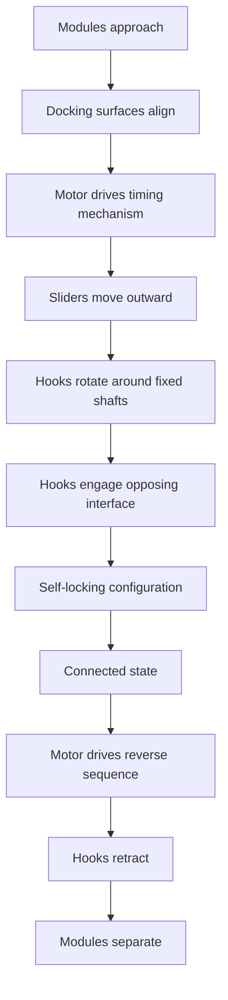
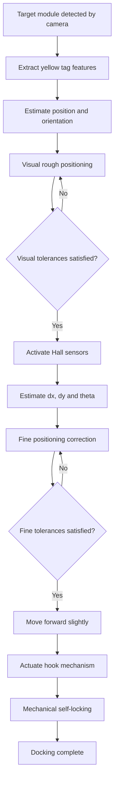

# A Multi-Sensory Autonomous Docking Approach for a Self-Reconfigurable Robot without Mechanical Guidance

> **How can two modular robots autonomously dock without relying on mechanical guide structures to correct alignment errors?**
>
> This paper presents an autonomous docking system combining an actively actuated hook-type connector with visual-sensor-guided rough positioning and Hall-sensor-guided fine positioning. Rather than relying on funnel-like or male-female mechanical guides to correct alignment, the system estimates relative position and orientation through sensors, adjusts the robot configuration, and then actuates the hook mechanism to establish a mechanical connection.

---

## 1. Paper Overview

| | Details |
|---|---|
| **Title** | A Multi-Sensory Autonomous Docking Approach for a Self-Reconfigurable Robot without Mechanical Guidance |
| **Authors** | Yanhe Zhu, Hongzhe Jin, Xueyuan Zhang, Jingchun Yin, Pijun Liu, Jie Zhao and co-authors |
| **Journal** | International Journal of Advanced Robotic Systems |
| **Year** | 2014 |
| **Volume** | 11, Issue 9 |
| **DOI** | [10.5772/58867](https://doi.org/10.5772/58867) |
| **Paper** | [Original article](https://journals.sagepub.com/doi/10.5772/58867) |
| **Full text** | [Read the full paper](https://journals.sagepub.com/doi/full/10.5772/58867) |
| **Robot platform** | UBot Self-Reconfigurable Robot (SRR) |
| **Research focus** | Autonomous docking without mechanical alignment guides |

---

## 2. Motivation

Autonomous docking is a fundamental capability of self-reconfigurable modular robots.

Modular robots need to connect and disconnect to form new structures, change locomotion configurations, adapt to their environments and potentially perform self-repair.

However, reliable docking is difficult because the two modules must achieve a sufficiently accurate relative position and orientation before their physical connectors can engage.

### Conventional docking approaches

Many existing docking systems use mechanical guiding structures to correct alignment errors.

These guides often consist of male-female geometries, funnels, tapered surfaces or other mechanical features that force the two modules towards a compatible alignment.

Although mechanical guides can improve docking robustness, they introduce additional physical constraints.

They may restrict the directions from which modules can connect or disconnect, thereby reducing the flexibility of modular reconfiguration.

The authors aim to address this problem by developing a docking system that relies on sensory guidance rather than mechanical guiding structures.

### The proposed approach

The paper combines two distinct subsystems:

1. **Hook-type mechanical connector:** An actively actuated mechanism physically locks the two modules together.
2. **Multi-sensory docking system:** A camera provides rough positioning, while Hall sensors provide precise relative-position and orientation information.

The robot first identifies and approaches the target module using visual information.

It then performs fine positioning using Hall sensors and the magnetic reference points installed on the docking surfaces.

Once the alignment conditions are satisfied, the hook mechanism is actuated to establish the connection.

### Design objectives

- Eliminate the need for external mechanical alignment guides.
- Achieve autonomous docking through sensory feedback.
- Use vision for long-range or rough positioning.
- Use Hall sensors for close-range alignment.
- Provide a strong and rigid physical connection.
- Keep the hook mechanism recessed beneath the module surface when not engaged.
- Preserve the flexibility of modular robot reconfiguration.

---

## 3. The UBot Modular Robot Platform

The docking system is designed around UBot, a self-reconfigurable modular robotic system.

UBot modules contain a twin-rotation mechanism that allows the modules to change their relative orientation and produce different locomotion and reconfiguration patterns.

### 3.1 Basic module structure

Each UBot module has:

- Four connecting surfaces.
- Two orthogonal rotational axes.
- Joint rotation from approximately -90° to +90°.
- Two micro-DC-geared motors for the twin-rotation mechanism.
- Embedded control and motor-driving electronics.
- Wireless communication hardware.
- Integrated connecting mechanisms on active modules.

The twin-rotation mechanism forms the main motion system of UBot.

It allows modules to rotate relative to one another, enabling locomotion, manipulation and self-reconfiguration.

### 3.2 Active and passive modules

The system distinguishes between active and passive modules based on their connecting mechanisms.

| Module | Connector structure |
|---|---|
| **Active module** | Contains the motor-driven hook-type connecting mechanism |
| **Passive module** | Contains docking holes and corresponding interface geometry, but no active hook mechanism on that surface |

The active and passive modules can connect through their mating surfaces.

The connector is designed to support docking through different connecting surfaces and orientations.

---

## 4. Hook-Type Connecting Mechanism

The central mechanical component of the paper is an embedded, motor-actuated hook-type connector.

Unlike the passive compliant latch in the Latching X-Face paper, this connector actively moves its hooks to establish and release the connection.

The hook mechanism is concealed beneath the module's surface when not being used.

This is important because an exposed connector could interfere with the locomotion or reconfiguration of the module.

The hooks extend only when a docking operation is initiated.

### 4.1 Connector architecture

The active docking surface contains four symmetrically arranged holes.

Inside each hole is a hook-type connecting element driven by a common motorized mechanism.

The corresponding passive module surface contains the mating holes.

The active and passive surfaces also contain orientating magnets near the hook locations. These magnets are used by the Hall sensors for relative-position and orientation estimation.

The magnets are not the primary mechanical locking mechanism.

The physical connection is established by the actively driven hooks.

### 4.2 Components of the hook mechanism

| Component | Function |
|---|---|
| **Hooks** | Engage the opposing module and provide mechanical retention |
| **Fixed shaft** | Provides the reference axis around which the hooks rotate |
| **Moving shaft** | Allows the hook geometry to rotate during actuation |
| **Sliders** | Move outward during engagement, driving the hook mechanism |
| **Centre timing wheel** | Coordinates the mechanism's movement |
| **Timing belt** | Transmits motion from the geared motor to the timing wheel |
| **Geared motor** | Actuates the connecting and release mechanism |
| **Mechanical rotation limit** | Limits the mechanism's motion and enables the self-locking configuration |
| **Position sensor** | Detects the state of the connecting mechanism |

---

## 5. How the Hook Mechanism Works

The connector is actively actuated.

The motor drives the central mechanism, which moves the sliders and rotates the hooks around their fixed shafts.

The hooks extend through the holes in the active docking surface and engage with the opposing module's connecting interface.

Once the hooks reach the required engagement configuration, the two module surfaces are mechanically fastened.

### 5.1 Attachment sequence

#### Step 1: The connector remains recessed

When the module is not docking, the hook features remain beneath the surface of the active module.

This prevents the connector from interfering with the robot's motion or other reconfiguration operations.

#### Step 2: The modules approach and align

The moving module approaches the target module using the docking guidance system.

The docking surfaces are brought into sufficiently accurate relative alignment.

#### Step 3: The sliders move outward

The geared motor drives the centre timing wheel through the timing belt.

The mechanism causes the sliders to move outward.

#### Step 4: The hooks rotate

The hooks rotate around their fixed shafts through the motion of the moving shaft.

The hook geometry moves into engagement with the opposing module's connecting interface.

#### Step 5: The modules become mechanically fastened

The hooks engage the mating geometry, creating a rigid mechanical connection between the modules.

### 5.2 Mechanical self-locking

The mechanism includes a mechanical rotation limit.

The centre timing wheel is driven slightly, approximately 2°, beyond its maximum stretch position.

This geometry prevents the hooks from being pulled back easily under the connection load.

The resulting mechanism has a self-locking property.

Once locked, it does not require continuous motor torque to maintain the connection.

This is important because it reduces energy consumption during the connected state.

### 5.3 Automatic disconnection

Unlike the Latching X-Face, this mechanism is actively reversible.

Disconnection is achieved through the reverse sequence of the connection operation.

The motor drives the mechanism in the opposite direction, retracting the hooks from their engagement positions.

The modules can then separate.

The active connector includes a position sensor that detects connection and disconnection states.

### Attachment and release sequence

---

## 6. Why the Connector Uses Magnets

The paper uses magnets, but they serve a sensing and orientation role rather than providing the mechanical locking force.

Four orientating magnets are installed near the hook-type connecting mechanism on the docking surfaces.

These magnets act as reference objects for the Hall sensors.

The sensory module contains a corresponding array of linear Hall sensors.

By measuring the magnetic field or corresponding sensor-distance information from the reference magnets, the system estimates relative alignment errors between the two docking surfaces.

### Magnet and Hall-sensor arrangement

| Component | Function |
|---|---|
| **Orientating magnets** | Provide magnetic reference points on the target docking surface |
| **Linear Hall sensors** | Measure the magnetic reference signals |
| **Four-sensor array** | Enables relative-position and orientation estimation |
| **Docking algorithm** | Converts the sensor information into alignment corrections |

The magnets therefore enable non-contact sensing.

They are not the hooks, and they are not the primary force holding the two modules together.

### Why this is useful

The system can estimate relative alignment without requiring the modules to physically touch each other through mechanical guides during the fine-positioning process.

This makes it possible to perform precise alignment through sensing and motion control.

---

## 7. Sensory Module

The docking system uses a dedicated sensory module.

The sensory module has a cubic structure compatible with the basic UBot module dimensions and contains several sensing components.

| Sensor | Purpose |
|---|---|
| **Wireless vision sensor / CCD camera** | Detects target-module features for rough positioning |
| **Linear Hall sensors** | Detect relative position and orientation during fine positioning |
| **Accelerometer** | Included for additional sensing functionality |
| **Infrared rangefinder** | Included for additional sensing functionality |

The camera and Hall sensor array are the primary sensors used in the docking algorithm described in the paper.

### 7.1 Visual sensing

The sensory module uses a camera to identify the target module.

Four symmetrically distributed round yellow tags are attached to the target module's connecting surfaces.

The visual system detects these features and calculates the relative position and orientation needed to approach the target.

### 7.2 Hall-sensor array

Four linear Hall sensors are installed on the docking surface of the sensory module.

They correspond to the four orientating magnets on the target module.

The Hall sensors are used for fine positioning once the robot is sufficiently close to the target.

They estimate the relative displacement and orientation errors between the docking surfaces.

---

## 8. Autonomous Docking Strategy

The paper divides the docking operation into three phases.

| Phase | Sensor / mechanism | Purpose |
|---|---|---|
| **1. Visual rough positioning** | Camera | Identify the target, determine the docking surface and correct large position and orientation errors |
| **2. Hall-sensor fine positioning** | Hall sensors and magnets | Estimate relative position and orientation at close range |
| **3. Docking execution** | Motor-driven hook mechanism | Engage and mechanically lock the modules |

This division is important because the camera and Hall sensors operate at different stages of the docking process.

The camera is used when the robot is farther from the target.

The Hall sensors are used when the modules are sufficiently close for accurate relative positioning.

The hook mechanism is actuated only after the alignment requirements have been satisfied.

---

## 9. Phase 1: Visual-Sensor-Guided Rough Positioning

The camera is used to detect the target module and estimate the relative position and orientation of the moving robot group.

The target module contains four round yellow tags.

The visual processing pipeline extracts the geometric features of these tags from the camera image.

### 9.1 Image-processing pipeline

The paper uses a sequence of image-processing operations to identify the target features.

| Step | Processing method | Purpose |
|---|---|---|
| 1 | RGB-to-HIS conversion | Separate colour information into hue, intensity and saturation |
| 2 | Saturation extraction | Identify the high-saturation yellow tag features |
| 3 | Top-hat transformation | Improve contrast and reduce illumination-related disturbances |
| 4 | Binarization | Convert the image into a binary representation |
| 5 | Morphological processing | Smooth boundaries and remove small noisy objects |
| 6 | Hough transformation | Extract ellipse geometry and feature-centre locations |

### 9.2 Why HIS colour space?

The authors use the HIS colour model rather than directly using RGB values.

The yellow tags have a relatively high saturation.

The saturation component helps distinguish the target features from the background.

Using the saturation component reduces the influence of lighting variation and correlated RGB colour disturbances.

### 9.3 Feature extraction

The camera detects the four yellow tag features.

The detected features are represented as ellipses in the image.

The Hough transformation is used to extract ellipse geometry and centre locations.

These locations are used to estimate the relative position and orientation of the moving module group with respect to the target module.

### 9.4 Determining the docking surface

The target module has multiple connecting surfaces.

The visual system must determine which surface is intended for docking.

The authors use the projection lengths of certain feature-centre line segments to distinguish the docking surface from an adjacent surface.

The surface with the larger projection length is identified as maintaining a smaller angle with the docking surface of the moving module group.

The other surface is used to determine the adjustment direction.

### 9.5 Relative position and orientation

The paper defines coordinate frames on the target module and sensory module.

The visual system calculates the horizontal offset and relative angular displacement.

The parameters include:

- \(\Delta P\): horizontal position offset.
- \(\Delta \phi\): angular displacement.
- \(\Delta D\): an additional geometric reference used to determine adjustment direction.

The estimated parameters are used to control the motion of the module group.

### 9.6 Visual positioning rules

The authors use a rule-based adjustment strategy.

The rules depend on the relative distance, position offset and angular displacement.

#### Rule 1: Large distance and significant horizontal offset

When the target is farther away and the horizontal offset exceeds the allowable tolerance, the module group rotates in the appropriate direction to correct the offset.

#### Rule 2: Large distance and small horizontal offset

When the offset is sufficiently small, the module group moves forward while performing the necessary rotational correction.

#### Rule 3: Close range and angular error

When the target is close, the module group corrects the angular displacement to align the docking surfaces.

#### Rule 4: Close range and horizontal offset

If the docking surfaces are approximately parallel but the horizontal offset remains outside the tolerance, the module group performs a combination of rotation, backward movement and corrective rotation.

This sequence allows the docking surface to return to a parallel configuration while eliminating the horizontal error.

### 9.7 Visual positioning thresholds

The visual positioning stage is considered complete when:

\[
|\Delta \phi| < 3^\circ
\]

and

\[
|\Delta P| < 4\text{ mm}
\]

Once these conditions are satisfied, the vision sensor is switched off and the system transitions to the Hall-sensor-guided fine positioning stage.

---

## 10. Phase 2: Hall-Sensor-Guided Fine Positioning

After visual rough positioning, the Hall sensors are used for precise relative positioning.

The sensory module moves closer to the target and obtains relative-position information from the four Hall sensors.

The target module has four orientating magnets corresponding to the Hall sensors.

The Hall sensors measure the magnetic reference information and the docking algorithm estimates relative displacement and orientation.

### 10.1 Estimated parameters

The system estimates:

| Parameter | Meaning |
|---|---|
| \(\Delta dx\) | Relative displacement along the first docking-axis direction |
| \(\Delta dy\) | Relative displacement along the second docking-axis direction |
| \(\Delta \theta_z\) | Relative rotational error about the vertical axis |

The coordinate frames of the target module and sensory module are established at the centres of their docking surfaces.

The relative transformation is modelled through translational and rotational components.

### 10.2 Coordinate transformation

The relative transformation can be represented as:

\[
T = T_{xy} R_z(\Delta \theta_z)
\]

where:

\[
T_{xy} =
\begin{bmatrix}
1 & 0 & 0 & \Delta dx \\
0 & 1 & 0 & \Delta dy \\
0 & 0 & 1 & 0 \\
0 & 0 & 0 & 1
\end{bmatrix}
\]

and:

\[
R_z(\Delta \theta_z) =
\begin{bmatrix}
\cos \Delta \theta_z & -\sin \Delta \theta_z & 0 & 0 \\
\sin \Delta \theta_z & \cos \Delta \theta_z & 0 & 0 \\
0 & 0 & 1 & 0 \\
0 & 0 & 0 & 1
\end{bmatrix}
\]

This transformation represents the relative position and orientation between the docking surfaces.

### 10.3 Hall-sensor measurements

The four Hall sensors provide measurements corresponding to the four magnets.

The authors derive equations relating the measured sensor-magnet distance information to the relative position and rotational error.

The unknowns are:

\[
\Delta dx,\quad \Delta dy,\quad \Delta \theta_z
\]

The system solves the corresponding equations to estimate the relative displacement and orientation.

The calculated parameters are then used to correct the robot's relative position and orientation.

### 10.4 Fine-positioning thresholds

The fine positioning is considered complete when:

\[
|\Delta dx| < 1\text{ mm}
\]

\[
|\Delta dy| < 1\text{ mm}
\]

\[
|\Delta \theta_z| < 2^\circ
\]

Once these conditions are satisfied, the moving module group advances slightly and the active module actuates the hook connector.

---

## 11. Complete Docking Control Pipeline

The overall docking sequence combines the visual and Hall-sensor stages.

### Step 1: Target detection

The camera identifies the target module and extracts its yellow tag features.

### Step 2: Visual rough positioning

The system estimates the relative horizontal position and orientation.

The robot adjusts its motion to reduce the position and angular errors.

### Step 3: Visual positioning completion

The visual positioning stage is completed when:

\[
|\Delta \phi| < 3^\circ
\]

and

\[
|\Delta P| < 4\text{ mm}
\]

### Step 4: Hall-sensor activation

The system switches to the Hall-sensor-guided fine positioning stage.

The Hall sensors measure the relative magnetic reference information.

### Step 5: Fine alignment

The system estimates:

\[
\Delta dx,\quad \Delta dy,\quad \Delta \theta_z
\]

and corrects the relative position and orientation.

### Step 6: Fine positioning completion

The fine alignment stage is completed when:

\[
|\Delta dx| < 1\text{ mm}
\]

\[
|\Delta dy| < 1\text{ mm}
\]

\[
|\Delta \theta_z| < 2^\circ
\]

### Step 7: Docking execution

The moving module group advances slightly.

The active module actuates its hook mechanism.

### Step 8: Mechanical locking

The hooks rotate and engage the opposing interface.

The mechanism reaches its self-locking configuration.

The modules are mechanically connected.

### Complete docking pipeline

---

## 12. Experimental Verification

The authors experimentally verify the docking system through two configurations.

### Experiment 1: Worm-shaped configuration

The first experiment demonstrates docking between a worm-shaped UBot module group and a target module.

The purpose is to verify the effectiveness of the proposed docking algorithm in a relatively simple configuration.

### Initial conditions

| Parameter | Value |
|---|---:|
| Initial distance | Approximately 300 mm |
| Initial relative orientation | Approximately 30° |
| Environment | Level floor |
| Configuration | Worm-shaped module group docking with a target module |

The docking operation is performed through visual rough positioning followed by Hall-sensor-guided fine positioning.

### Experimental result

The authors report:

| Phase | Time |
|---|---:|
| Visual rough positioning | Approximately 21 s |
| Hall-sensor-guided precise positioning | Approximately 26 s |
| Total positioning time | Approximately 47 s |

After the positioning stages, the active module actuates the hook-type connector and the docking operation is completed.

The paper reports successful docking in this experiment.

The reported times refer to the positioning stages; they should not be interpreted as a universal docking time for the system.

---

## 13. Experiment 2: T-Shaped Reconfiguration

The second experiment demonstrates docking involving two moving module groups and a static module group.

The goal is to form a T-shaped configuration.

This experiment demonstrates docking between multiple moving robot groups rather than only between a single worm-shaped group and one target module.

### Initial conditions

| Parameter | Value |
|---|---:|
| Initial docking distance | Approximately 100 mm |
| Configuration | Two moving module groups docking with a static module group |
| Final configuration | T-shaped arrangement |

### Experimental result

The authors report that the entire docking process takes approximately 40 seconds.

The resulting configuration demonstrates that the docking approach can be used to form a T-shaped structure through autonomous docking.

---

## 14. Experimental Results Summary

| Experiment | Initial distance | Initial orientation | Positioning / docking time | Result |
|---|---:|---:|---:|---|
| Worm-shaped configuration | Approximately 300 mm | Approximately 30° | 21 s rough positioning + 26 s fine positioning | Successful docking |
| T-shaped configuration | Approximately 100 mm | Not specified as a numerical value | Approximately 40 s | Successful T-shaped docking |

The authors also conclude that the proposed approach can perform the docking process within a distance range of approximately 1 metre through the combination of visual and Hall-sensor information.

This should be interpreted as the reported operating range of the proposed approach, not as a guarantee for every initial position, orientation or environment.

---

## 15. What the Paper Demonstrates

| Capability | Demonstrated |
|---|---|
| Hook-type mechanical connector | Yes |
| Motor-actuated attachment | Yes |
| Motor-actuated release | Yes, through the reverse mechanism sequence |
| Mechanical self-locking | Yes |
| Recessed connector when not docking | Yes |
| Visual target detection | Yes |
| Yellow-tag feature extraction | Yes |
| Visual rough positioning | Yes |
| Hall-sensor-guided fine positioning | Yes |
| Magnet-assisted non-contact alignment sensing | Yes |
| Docking without external mechanical guides | Yes |
| Worm-shaped docking experiment | Yes |
| T-shaped docking experiment | Yes |
| Autonomous docking control | Yes |
| Experimental validation | Yes |

---

## 16. Limitations

The paper demonstrates an autonomous docking strategy for UBot modular robots.

It does not establish a universal docking mechanism suitable for every mobile robot configuration.

### Mechanical limitations

- The hook mechanism requires a motor, transmission and moving components.
- The connector is more mechanically complex than a passive snap-fit latch.
- The mechanism must be integrated into the module geometry.
- The locking mechanism is designed around the UBot interface.
- The connector requires compatible mating surfaces.

### Sensor limitations

- The visual system depends on recognizable target features.
- The yellow-tag feature extraction approach is dependent on image conditions and feature visibility.
- The Hall-sensor system requires the magnetic references to be positioned appropriately.
- The fine-positioning system is designed around a particular sensor and magnet arrangement.

### Control limitations

- The rough positioning algorithm uses a rule-based adjustment strategy.
- The visual positioning stage is relatively complex and time-consuming.
- The authors identify simplification of the rough-positioning algorithm as future work.
- The experiments do not establish docking performance under all environmental conditions.

### Generalization limitations

The system was designed for UBot modular robots.

Although the authors state that the approach could be extended to other self-reconfigurable robots, the mechanical interface, sensing arrangement and motion-control algorithm would need adaptation.

---

## 17. Application to Independently Mobile Robots

This paper is more directly relevant to autonomous docking than the Latching X-Face paper because it demonstrates a complete docking pipeline involving:

- Target detection.
- Relative positioning.
- Orientation correction.
- Fine alignment.
- Active mechanical attachment.

However, the system is still designed around UBot's modular architecture and locomotion.

### What could be adapted?

| Component | Possible adaptation for mobile robots |
|---|---|
| Hook-type connector | Custom motor-driven hooks or locking mechanism |
| Camera-based rough positioning | Camera, fiducial markers, OpenCV or another perception system |
| Hall-sensor fine positioning | Hall sensors and magnetic reference points |
| Position correction | Differential-drive motion controller |
| Hook actuation | Servo, geared motor or suitable transmission |
| Docking detection | Position sensor, limit switch or actuator feedback |
| Release | Reverse actuation sequence |
| Reconfiguration | Robot-level motion planning and control |

### Example mobile-robot docking sequence

1. Robot A identifies Robot B using a camera or fiducial marker.
2. Robot A estimates the relative position and orientation of Robot B.
3. Robot A approaches and performs rough alignment.
4. Hall sensors provide close-range relative-position information.
5. Robot A corrects its position and orientation.
6. Robot A moves forward slightly.
7. The active connector actuates and engages the hooks.
8. The connector reaches its self-locking state.
9. A sensor verifies engagement.
10. To disconnect, the connector is actively released and the robots move apart.

This would require adapting the connector geometry and control system to the mobile robots' dimensions, dynamics and docking configuration.

---

## 18. Comparison with the Latching X-Face

The two papers address modular robot connection, but their mechanisms and docking philosophies are substantially different.

| Feature | Latching X-Face (2014) | Multi-Sensory Hook Docking (2014) |
|---|---|---|
| **Mechanical mechanism** | Passive compliant latch | Motor-driven hook mechanism |
| **Attachment** | Modules push together and latch through compliant deformation | Motor actuates sliders and rotating hooks |
| **Release** | Manual out-of-plane displacement in the original prototype | Motor-driven reverse mechanism |
| **Magnets** | Not used in the latch | Used as reference points for Hall-sensor alignment |
| **Mechanical guides** | Uses mating connector geometry for alignment | Avoids external mechanical alignment guides |
| **Alignment method** | Passive geometry and module forces | Vision followed by Hall-sensor-guided fine positioning |
| **Actuator for attachment** | No dedicated latch actuator | Dedicated motorized hook mechanism |
| **Self-locking** | Mechanical retention through latch geometry | Mechanical self-locking through hook mechanism geometry |
| **Docking sensing** | Not the focus of the paper | Explicitly integrated into docking pipeline |
| **Autonomous docking** | Not demonstrated between independent mobile robots | Demonstrated in UBot reconfiguration experiments |
| **Reconfiguration experiments** | P-shape, block and O-shape configurations | Worm-shaped and T-shaped configurations |

### The fundamental difference

**Latching X-Face:**

The connector's geometry itself helps the mating faces align and mechanically latch as the modules move together.

**Multi-Sensory Hook Docking:**

The robot senses its relative position and orientation, corrects the alignment through motion control, and then actively actuates a hook mechanism to establish the connection.

The second approach separates the alignment problem from the mechanical locking problem more explicitly.

---

## 19. Key Takeaways

- The paper proposes an autonomous docking approach for self-reconfigurable UBot robots.
- It combines a motor-driven hook connector with multi-sensory alignment.
- The hook mechanism is embedded beneath the docking surface when not in use.
- The active mechanism uses sliders, rotating hooks, shafts, a timing wheel and a timing belt.
- The connector has a self-locking configuration and does not require continuous motor torque to maintain locking.
- The connector can be released through the reverse actuation sequence.
- Four orientating magnets are used as reference points for Hall sensors.
- The magnets are used for sensing and alignment, not as the primary mechanical locking mechanism.
- The camera performs rough positioning using yellow tag features.
- The Hall sensors perform fine positioning using the magnetic reference arrangement.
- Visual positioning thresholds are approximately 3° angular error and 4 mm horizontal offset.
- Hall-sensor fine positioning thresholds are approximately 1 mm in each measured translational direction and 2° rotational error.
- The authors demonstrate worm-shaped and T-shaped docking.
- The worm-shaped docking experiment starts from approximately 300 mm distance and 30° relative orientation.
- The reported positioning times for the worm-shaped experiment are approximately 21 seconds for rough positioning and 26 seconds for fine positioning.
- The T-shaped docking experiment takes approximately 40 seconds.
- The paper demonstrates docking without external mechanical alignment guides.

---

## 20. References

### Primary paper

- [A Multi-Sensory Autonomous Docking Approach for a Self-Reconfigurable Robot without Mechanical Guidance](https://journals.sagepub.com/doi/10.5772/58867)
- [Full text](https://journals.sagepub.com/doi/full/10.5772/58867)
- [DOI: 10.5772/58867](https://doi.org/10.5772/58867)

### Related modular robotics papers

- [Design, Principles, and Testing of a Latching Modular Robot Connector](https://www.modlabupenn.org/wp-content/uploads/latching_xface_overlay.pdf)
- [The X-Face: An Improved Planar Passive Mechanical Connector for Modular Self-Reconfigurable Robots](https://www.modlabupenn.org/wp-content/uploads/X-Face.pdf)

---

*This README summarizes and interprets the connector design, sensing architecture, docking algorithm and experimental results presented in the original paper. Adaptations for independently mobile robots are discussed separately from the authors' demonstrated UBot system.*
